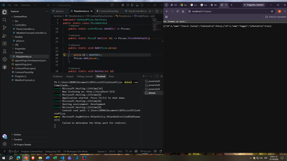
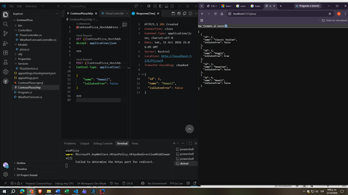
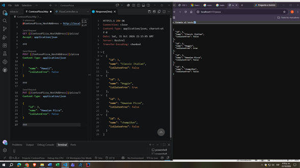
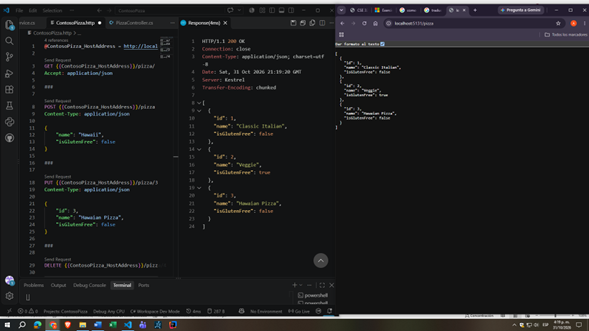

# W01 Assignment Notes

1. Pizza API Evidence


- GET request showing the existing pizzas.


- POST request.



- PUT request.



- DELETE request.



2. API CRUD Operations

GET {{ContosoPizza_HostAddress}}/pizza/
Accept: application/json

HTTP/1.1 200 OK
Connection: close
Content-Type: application/json; charset=utf-8
Date: Sat, 31 Oct 2026 23:54:59 GMT
Server: Kestrel
Transfer-Encoding: chunked

[
  {
    "id": 1,
    "name": "Classic Italian",
    "isGlutenFree": false
  },
  {
    "id": 2,
    "name": "Veggie",
    "isGlutenFree": true
  }
]
###

POST {{ContosoPizza_HostAddress}}/pizza
Content-Type: application/json

{
    "name": "Hawaii",
    "isGlutenFree": false
}
HTTP/1.1 201 Created
Connection: close
Content-Type: application/json; charset=utf-8
Date: Sat, 31 Oct 2026 23:55:40 GMT
Server: Kestrel
Location: http://localhost:5131/Pizza/3
Transfer-Encoding: chunked

{
  "id": 3,
  "name": "Hawaii",
  "isGlutenFree": false
}
###

PUT {{ContosoPizza_HostAddress}}/pizza/3
Content-Type: application/json

{
    "id": 3,
    "name": "Hawaian Pizza",
    "isGlutenFree": false
}
HTTP/1.1 204 No Content
Connection: close
Date: Sat, 31 Oct 2026 23:56:10 GMT
Server: Kestrel


###

DELETE {{ContosoPizza_HostAddress}}/pizza/4


HTTP/1.1 204 No Content
Connection: close
Date: Sat, 31 Oct 2026 23:57:23 GMT
Server: Kestrel


###


3. Sales Summary Function

The following function was added to the Work with files and directories in a .NET app module to generate a sales summary report file.

```csharp
void GenerateSalesSummary(IEnumerable<string> salesFiles, string outputDirectory)
{
    StringBuilder report = new StringBuilder();

    double totalSales = 0;

    report.AppendLine("Sales Summary");
    report.AppendLine("----------------------------");

    report.AppendLine();
    report.AppendLine("Details:");

    foreach (var file in salesFiles)
    {
        string salesJson = File.ReadAllText(file);

        SalesData? data =
            JsonConvert.DeserializeObject<SalesData?>(salesJson);

        double fileTotal = data?.Total ?? 0;

        totalSales += fileTotal;

        string fileName = Path.GetFileName(file);

        report.AppendLine($"{fileName}: {fileTotal:C}");
    }

    report.Insert(
        report.ToString().IndexOf("Details:"),
        $" Total Sales: {totalSales:C}{Environment.NewLine}{Environment.NewLine}"
    );

    string reportPath = Path.Combine(outputDirectory, "sales-summary.txt");

    File.WriteAllText(reportPath, report.ToString());
}
```

Result: 
Sales Summary
----------------------------

 Total Sales: $ 2.012,20

Details:
sales.json: $ 88,88
sales.json: $ 501,22
salestotals.json: $ 0,00
sales.json: $ 1.234,22
salestotals.json: $ 0,00
sales.json: $ 99,00
salestotals.json: $ 0,00
sales.json: $ 88,88
salestotals.json: $ 0,00
